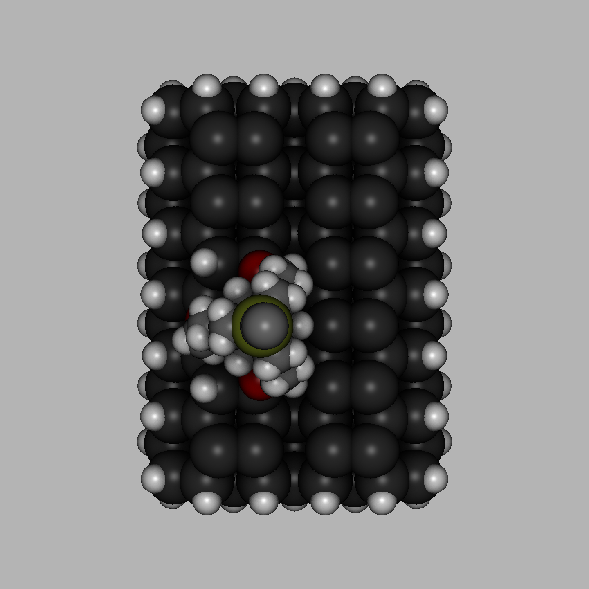
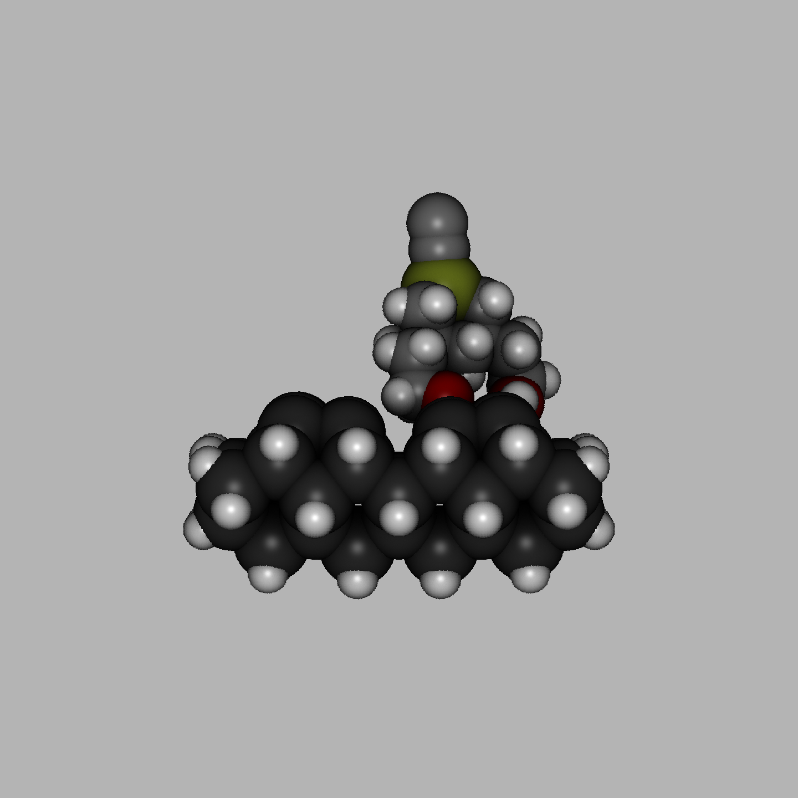
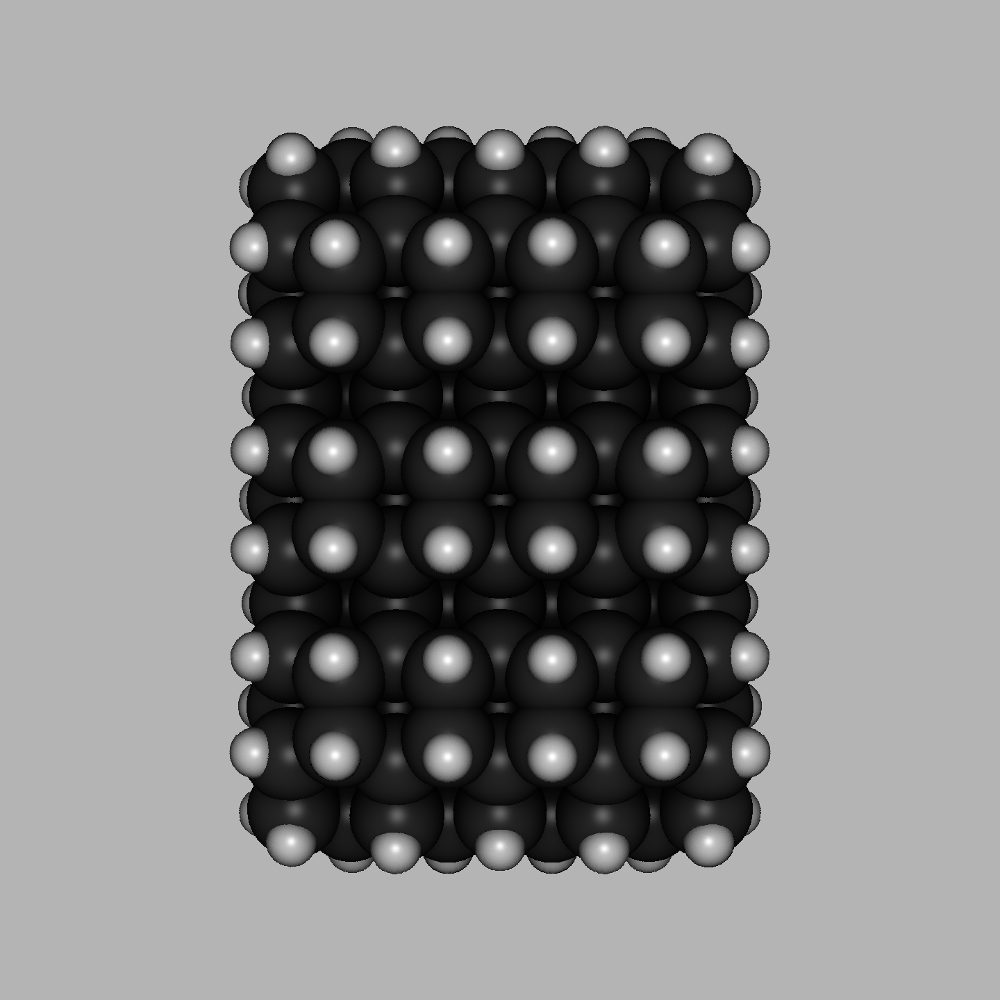
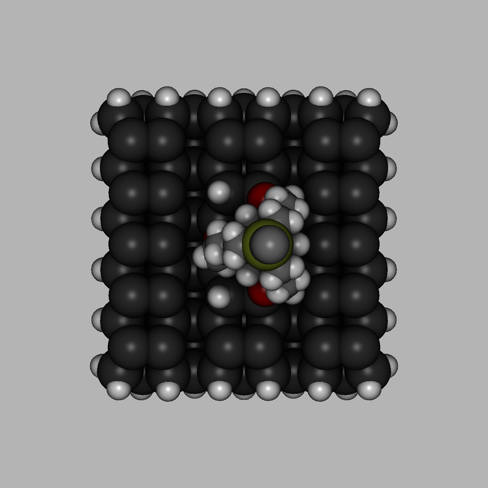
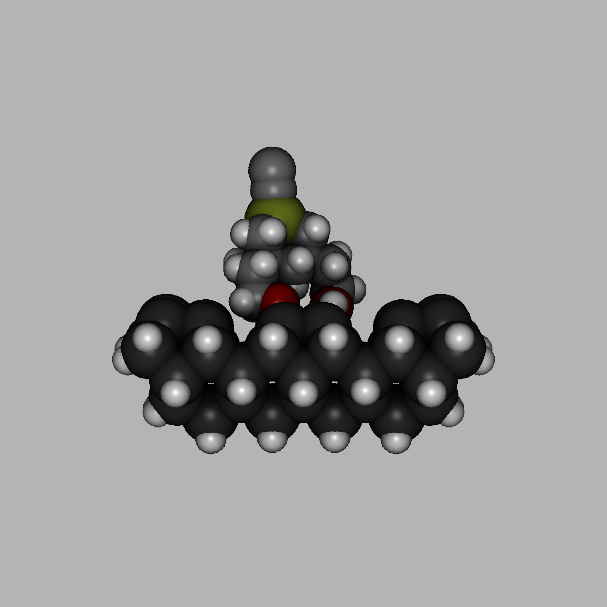
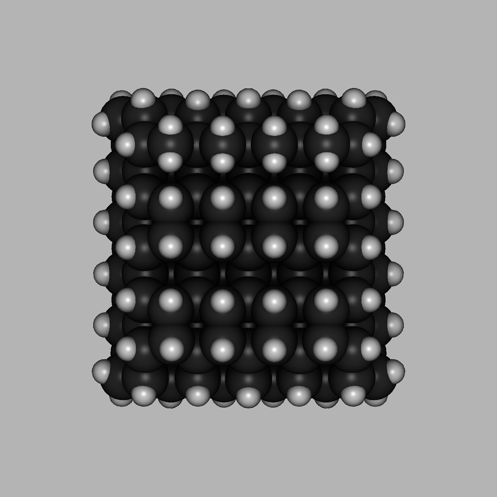
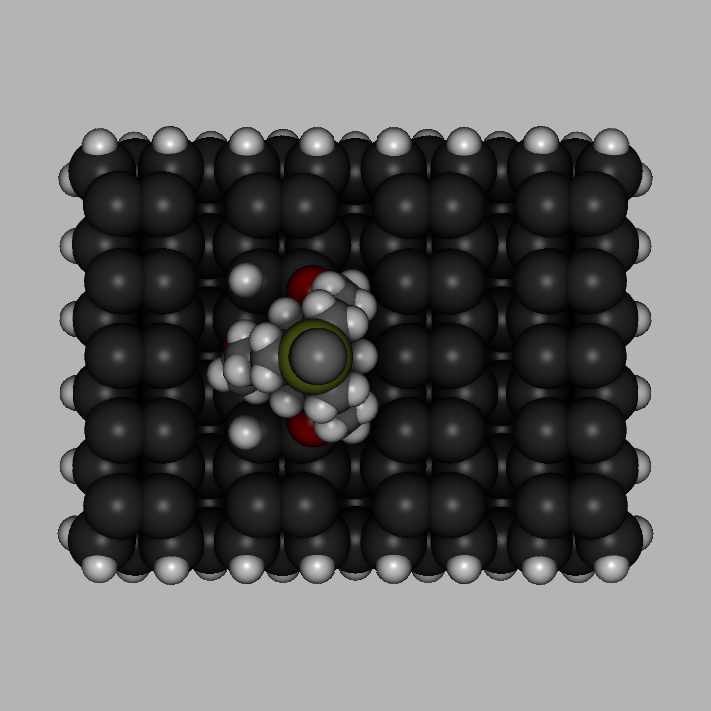
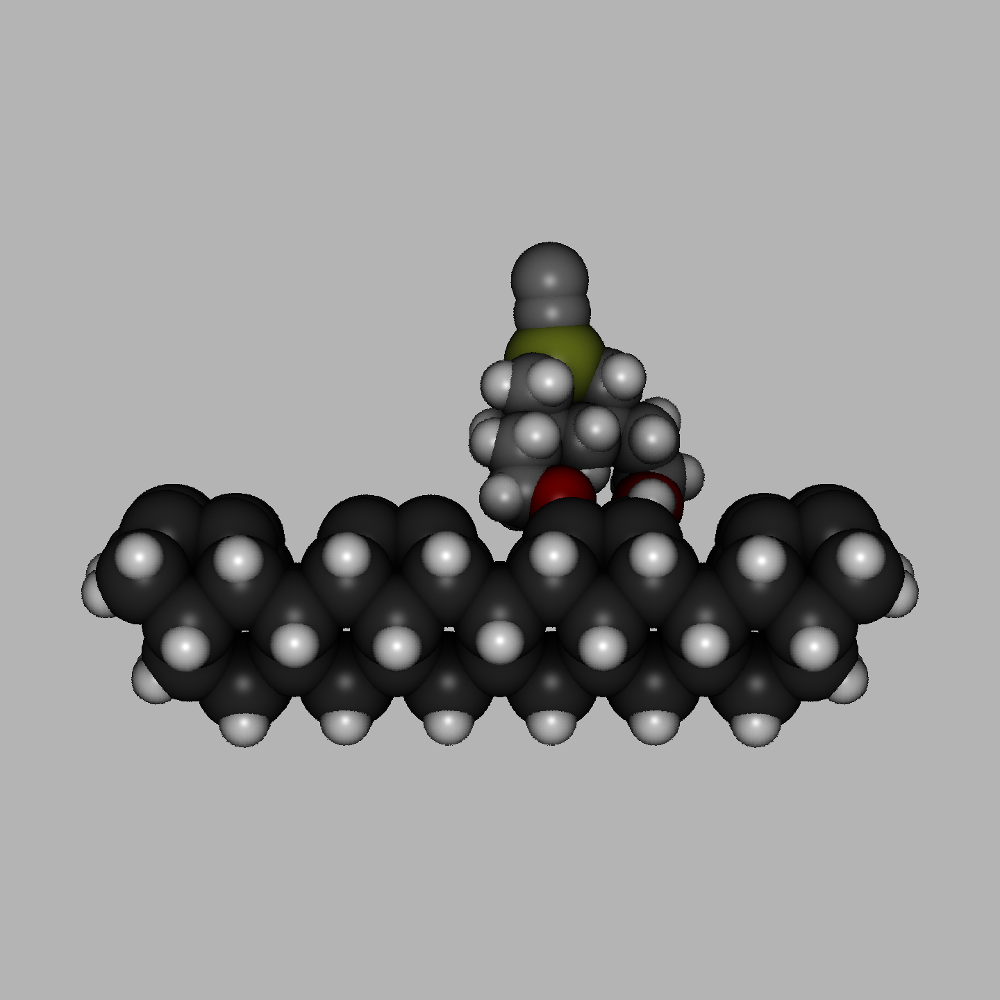
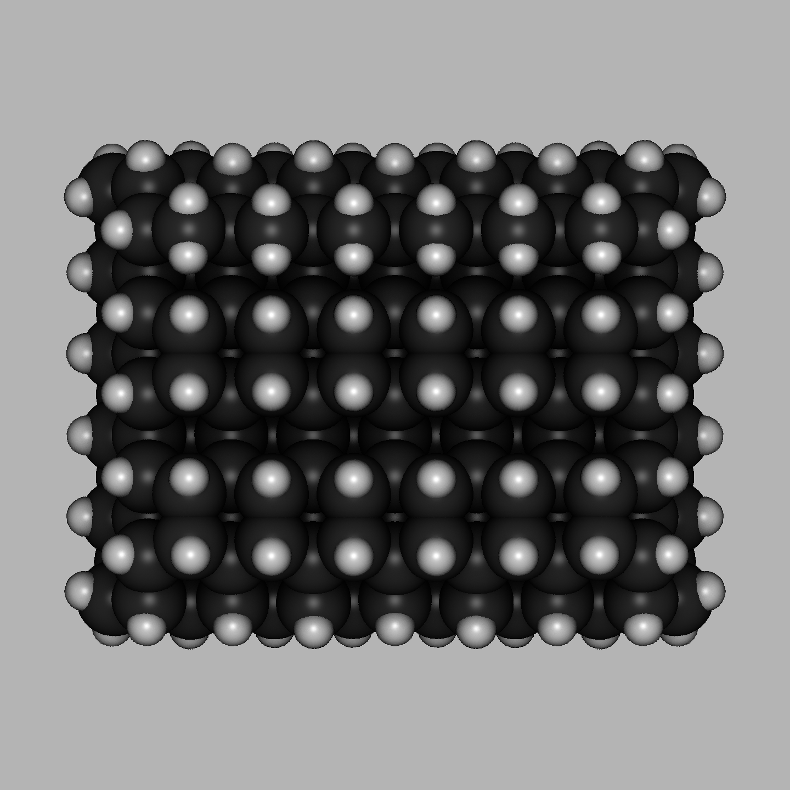

# Tripod Renders (10/22/2026)

Some oddly satisfying images I'd like to share. Publishing on GitHub, not X, because going there would distract from where attention needs to be focused (getting funded & IRL, non-computational experiments).

There are about 21 different plausible binding configurations for EAOGe-C2 on bare Si(100), de-duplicating symmetry equivalent ones. S36 and S42 are just two of them.

The large clusters will go into DFT / Runpod, but just singlepoints. The goal is to get a good set of converged orbitals to calculate Fermi level whatever and get accurate understanding of what contributes to STM images.

## MM4 Slab Minimized, Slab-Agnostic Tool Tilt

Meaning the tool structure prior to GFN2 minimization is just the structure already cached from a cheap GFN2:MM4 or GFN2:GFN-FF:MM4 ONIOM model.

### S36, 2 x 6 dimers

&nbsp;
  
&nbsp;&nbsp;
  
&nbsp;&nbsp;
  
&nbsp;

### S36, 3 x 5 dimers

&nbsp;
  
&nbsp;&nbsp;
  
&nbsp;&nbsp;
  
&nbsp;

### S36, 4 x 5 dimers

&nbsp;
  
&nbsp;&nbsp;
  
&nbsp;&nbsp;
  
&nbsp;

## GFN2 Minimized, Slab + Tool Together

This was notoriously hard to energy minimize. Un-buckled dimers have 0.00 eV bandgap in GFN2, while buckled ones have 0.21–0.54 eV bandgap. These slabs are some of the hardest ones to converge with the SCF, requiring more iterations and higher electronic temperature even when they do work.

Conclusion: all attempts to fix charge sloshing in the xTB Fortran code failed. None of the structures above can be energy minimized with GFN2.
